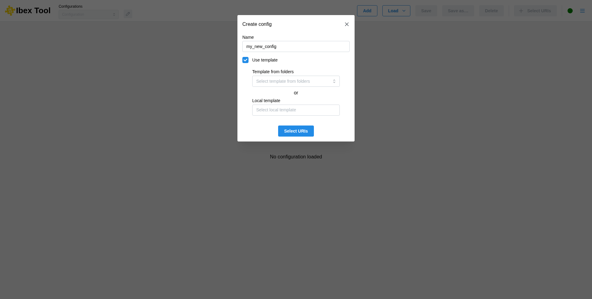

.. _`Add configuration`:

===================
Add configuration
===================

The “Add” button allows you to create a new configuration; you just need to provide a name for it.

It is possible to create a configuration from a template. To do this, you must tick the “Use template” box and then select a configuration file.

There are two ways to do this:

* The first is to select a configuration from a list of predefined folders in the user preferences (see :doc:`Preferences <preferences_menu>`).
* The second option is to select a local file directly from your machine.

Once the configuration has been created, it will then be necessary to add URIs (see :doc:`Add uri <add_uri>`).

The name can be changed later (see :doc:`Rename configuration <rename_configuration>`).

From the command line
---------------------

A configuration can also be created at startup, directly with its data entries (see
:ref:`Command-line options`):

.. code-block:: bash

   # New configuration named "compare", with two data entries
   ./launch.sh -u "imas:hdf5?path=/path/to/entry1" "imas:hdf5?path=/path/to/entry2" -n compare

   # New configuration named "kinetic", from a template installed with IBEX
   ./launch.sh -u "imas:hdf5?path=/path/to/entry" -n kinetic -t PlotKineticProfiles

With ``--template`` (``-t``), the template is given as a file path, or by its name: ``ibex --help``
lists the templates installed with IBEX, and the templates in the folders set in the
:doc:`Preferences <preferences_menu>` can be given by name as well. A name is then required
(``--name``, ``-n``). The data entries fill the template's ``URI-0``, ``URI-1``, ... in the order
they are given, and its plots are drawn at once. If the template uses more data entries than were
given, the configuration opens with the "Select URIs" dialog so that you can add the missing ones.