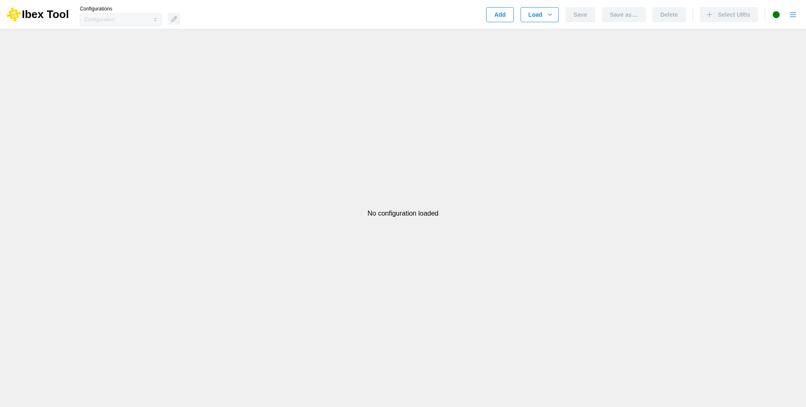

.. _`First window`:

===================
First window
===================

At the launch of the application, you will see this window: 

On this screen, you will be required to either create a new configuration (“:doc:`Add <add_configuration>`”) or load an existing one from your local machine (“:doc:`Load <load_configuration>`”).

The buttons at the top right, before the separator, allow you to manage your configurations: create ("Add"), load ("Load"), save ("Save" and "Save as…", see :doc:`Save configuration <save_configuration>`) and delete ("Delete"). You can switch between configurations using the selection menu at the top left, and rename the current one with the pencil button next to it (see :doc:`Rename configuration <rename_configuration>`).

To the right of the separator, you can add new URIs (see :doc:`Add uri <add_uri>`).

On the far right, a dot indicates the server status.

.. tip::

   IBEX can also start directly on configurations or data entries given on the command line, see
   :ref:`Command-line options`.