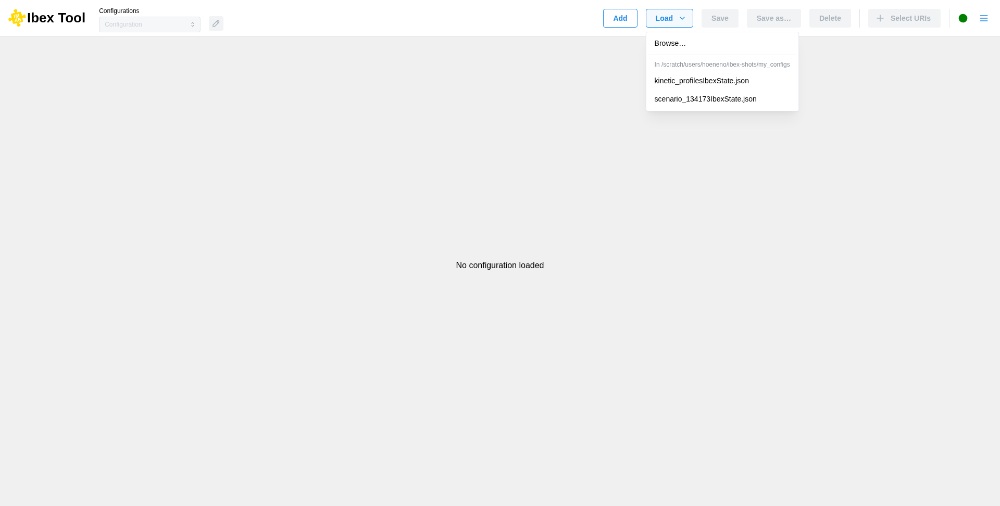

.. _`Load configuration`:

===================
Load configuration
===================

To load an existing local configuration, you can use the “Load” menu. It lists the “.json” files of the directory IBEX was started from, so that one click loads one of them; “Browse…” opens the file explorer to find a file anywhere else. This configuration reflects the state of your application at the time of the last save.

Make sure to save your configuration by clicking the “Save” button so that you can load it later and pick up right where you left off. 

When loading a configuration, the data must match the expected JSON format to be valid.

Configuration files can also be loaded when starting IBEX, with ``--config`` (``-c``) followed by
one or more files, each opened in its own configuration (see :ref:`Command-line options`):

.. code-block:: bash

   ./launch.sh -c myRunIbexState.json otherIbexState.json
 