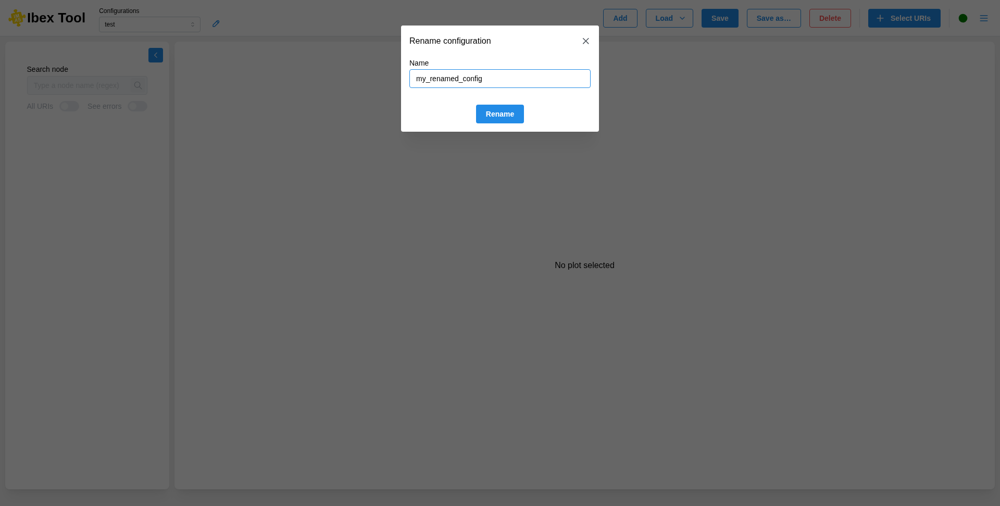

.. _`Rename configuration`:

====================
Rename configuration
====================

To rename the current configuration, click the pencil button to the right of the configuration
selector. A dialog opens with the current name, ready to be edited.

Change the name and click "Rename". The name must not be empty, and must not be used by another open
configuration.

After a rename, the configuration is marked as modified. If it was already saved to a file, it stays
linked to that file: clicking "Save" writes the new name into the same file. To keep the file with
the old name untouched, use "Save as…" instead (see :doc:`Save configuration <save_configuration>`).
