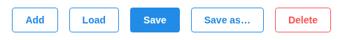
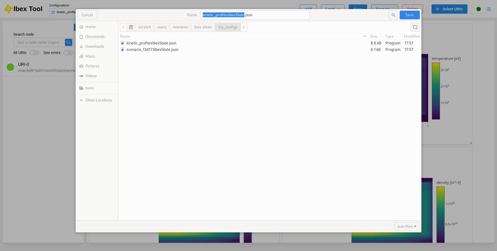

.. _`Save configuration`:

===================
Save configuration
===================

Two buttons save the current configuration, so that you can return to it later. The configuration is saved in a .json file (see :doc:`Configuration file <configuration_file>`). This file can be edited manually, and any changes will be applied when the file is loaded.

**Save** writes the configuration to its file. The first time a configuration is saved, a file
explorer opens so that you can choose the name and location of the file. After that, "Save" simply
updates the same file, and is greyed out while there is nothing new to save.

**Save as…** always opens the file explorer, starting in the folder of the current file, so that you
can save the configuration to another file, for example to keep the previous version. The
configuration is then linked to the new file: the next "Save" writes to it.

Make sure to save your configuration if you want to access it again in the future. If a file cannot
be written, an error is shown and the configuration stays marked as modified.
